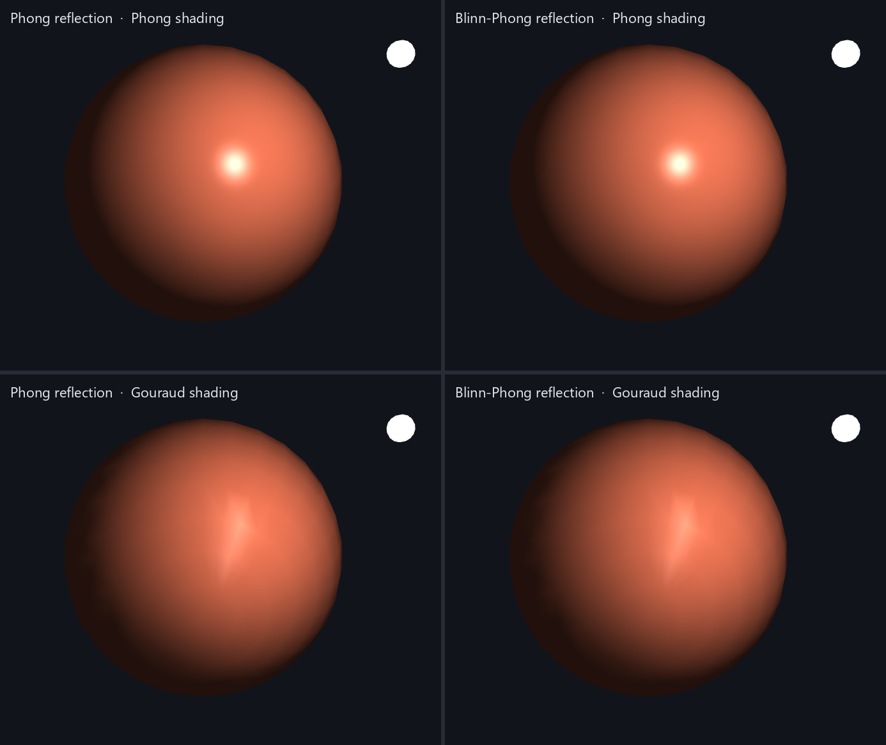
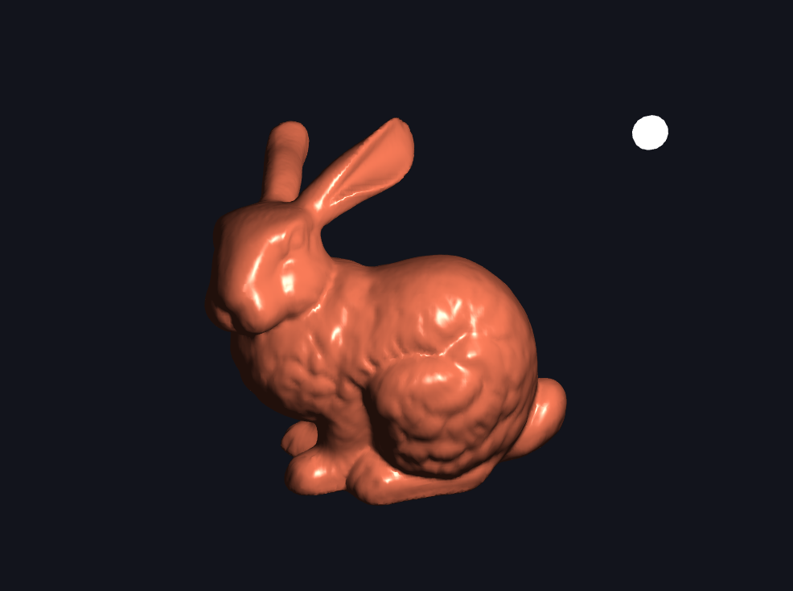

# Task 09 — Phong and Blinn-Phong illumination

> Implement the Phong and Blinn-Phong illumination methods using Gouraud Shading
> and Phong Shading. Your demo should be able to switch between Phong and Blinn
> Phong, as well as between Gouraud Shading and Phong Shading; to do this, you
> can add keyboard interactions.
>
> Submit an image showing your result, and update your repository.

**Status:** ✅ done

## Result

The generated sphere (32 × 16, 482 vertices) with the light paused at the same
position, in the four combinations. Top row: Phong shading, the highlight is a
round spot. Bottom row: Gouraud shading, the same highlight is sampled only at
the vertices and interpolated, so it takes the shape of the triangles around it.
Left and right columns barely differ: that is the point of the `4n` exponent
(see below).



The Stanford bunny, Phong reflection with Phong shading; the white dot is the light:



## Approach

### The reflection model

`illuminate(position, normal)` in `src/main.cpp` is the equation from the class
slides, evaluated in world space with a point light and the camera position
taken from the shared camera:

```
I = ka·Ia + kd·Id·max(0, N·L) + ks·Is·max(0, R·V)^n          Phong
I = ka·Ia + kd·Id·max(0, N·L) + ks·Is·max(0, N·H)^(4n)       Blinn-Phong

R = 2(N·L)N − L          H = (L + V) / |L + V|
```

- **Ambient** `ka·Ia`: a constant, so the side away from the light is not black.
- **Diffuse** `kd·Id·max(0, N·L)`: Lambert, depends only on the light direction.
- **Specular**: depends on the viewer too. Phong measures how close the
  reflected ray `R` is to the viewer `V`; Blinn-Phong measures how close the
  halfway vector `H` is to the normal `N`, which avoids computing the reflection.

`ka = kd` is the surface colour and `ks` is grey, so the highlight takes the
colour of the light. A surface facing away from the light (`N·L ≤ 0`) gets no
specular term: `R·V` can still be positive there and would light the dark side.

**Why `4n`.** The angle between `N` and `H` is about half the angle between `R`
and `V`, so with the same exponent the Blinn-Phong highlight is much larger.
The slides suggest `n_blinn ≈ 4·n_phong`, which keeps both highlights about the
same size; `↑` / `↓` change `n` for both.

### Gouraud vs Phong shading

The equation is written once, as a GLSL string, and compiled into two programs.
`glShaderSource` takes an array of strings and concatenates them, so the
`#version` line, the shared function and each stage's `main` are passed as
separate pieces:

| Program | Vertex stage | Fragment stage |
|---|---|---|
| Gouraud | `illuminate()` per **vertex** → `vColor` | writes the interpolated colour |
| Phong | passes world position and normal | renormalises the interpolated normal, `illuminate()` per **fragment** |

Both declare the same uniforms, so the render loop picks
`gGouraud ? gouraud : phong` and feeds either with the same code. `G` only
changes which program draws; `B` flips `uBlinn` inside the shared function.

What the comparison shows:

- **Gouraud** evaluates the model 482 times on the sphere. A highlight smaller
  than a triangle is either missed or smeared into the triangle's shape, and it
  jumps from vertex to vertex while the light moves.
- **Phong shading** evaluates it for every pixel. The interpolated normal is
  shorter than 1 inside a triangle, so it must be normalised again, which is
  step 3 of the algorithm in the slides.
- On the bunny (35 947 vertices, triangles a few pixels wide) both look almost
  the same, the Gouraud highlights are only slightly softer: Gouraud is visibly
  worse only when triangles are large compared with the highlight.

### Reused from earlier tasks

- The mesh is an L1 CHE (task 03/04), loaded from `.ply` or generated (task 06);
  the vertex normals are `CHE::vertex_normals()`, area-weighted from the star.
- The camera is `common/camera.hpp` (task 08): arcball drag, scroll zoom and the
  animated orbit. Its `position()` is the viewer position `V` needs.

## Controls

| Key / mouse | Action |
|-------------|--------|
| `B` | Reflection model: Phong ↔ Blinn-Phong |
| `G` | Shading: Phong ↔ Gouraud |
| `↑` / `↓` | Shininess `n`, 2–256 (Blinn-Phong uses `4n`) |
| `SPACE` | Pause / resume the light orbit and the animated camera |
| `C` | Switch animated camera ↔ mouse camera |
| Left drag / scroll | Arcball rotation · zoom |
| Drop a `.ply` on the window | Load it |
| `R` | Reset light and camera |
| `W` | Toggle wireframe |
| `ESC` | Quit |

The title bar shows the mesh, the reflection model, the shading and `n`.

## Run

```sh
cmake --build --preset <preset> --target task09
./build/<preset>/task-09-illumination/task09                          # sphere
./build/<preset>/task-09-illumination/task09 torus
./build/<preset>/task-09-illumination/task09 ../task-06-fast-marching/models/bunny.ply
./build/<preset>/task-09-illumination/task09 sphere torus --check     # stats, no window
```

## Layout

```
src/
├── che.hpp / che.cpp            L1 CHE, the same data structure tasks 04 and 06 use
├── primitives.hpp / .cpp        generated test meshes: make_sphere, make_torus
├── mesh_io.hpp / .cpp           load_ply(): happly -> centred, triangulated CHE
└── main.cpp                     illuminate(), Gouraud and Phong programs, orbiting light
```

## Notes / what I learned

- Reflection model and shading are two independent choices. The model is *what*
  is computed (Phong or Blinn-Phong); the shading is *where* it is computed
  (per vertex or per fragment). That is why the demo has two separate keys.
- Gouraud and Phong shading run exactly the same function. Moving one call from
  the vertex shader to the fragment shader is the whole difference, and it is
  enough to change the highlight from a polygon into a circle.
- Interpolating unit vectors does not give unit vectors; without the
  `normalize` in the fragment shader the centre of each triangle looks darker.
- Phong and Blinn-Phong highlights only match in size after scaling the exponent;
  with the same `n`, the Blinn-Phong highlight would be much wider.
- The light is only a position and a colour. Nothing blocks it: the model lights
  itself even where another part of the surface is in between, which is what
  shadow mapping, the next topic in the slides, solves.
