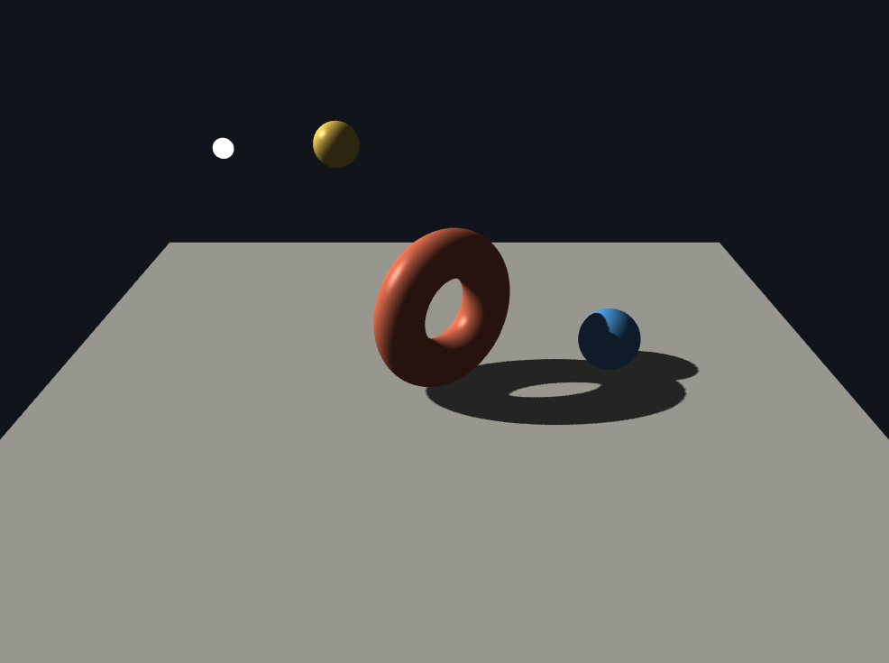
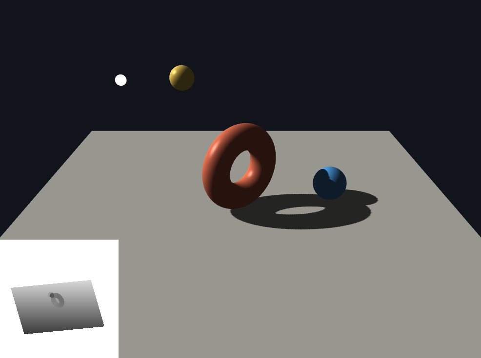
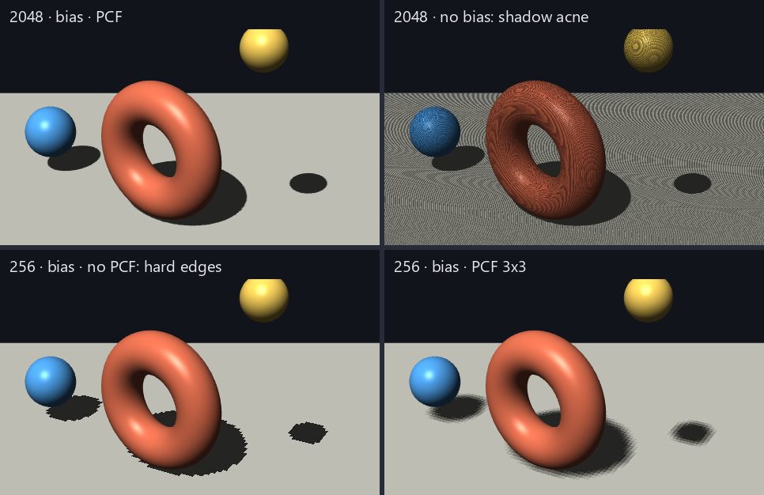
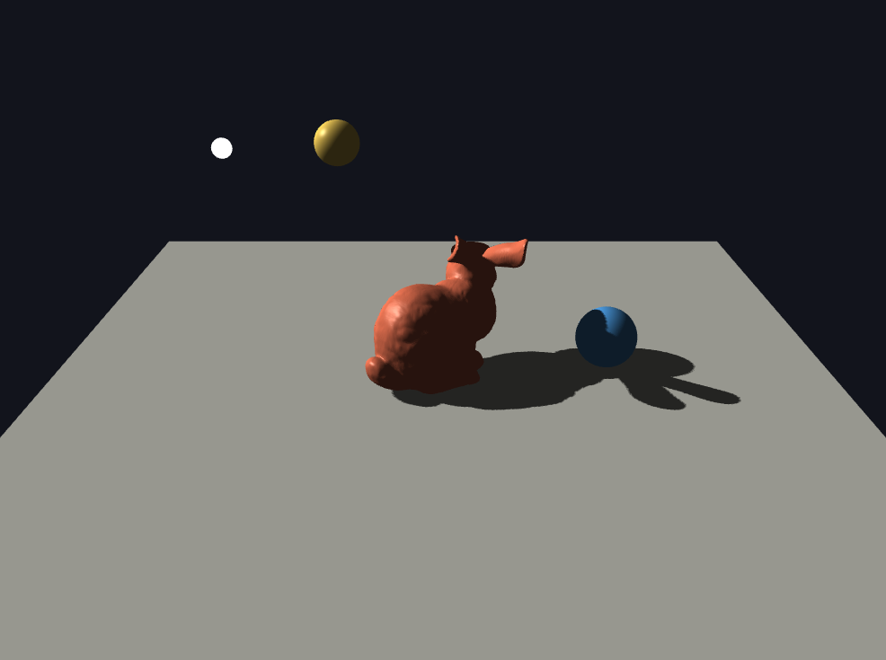

# Task 10 — Shadow Mapping

> Implement the 2-pass Shadow Mapping algorithm. Some of the steps are:
>
> - Design an animated scene where there is an object that potentially occludes others.
> - Animate the light source, move around the scene objects.
> - Run the 2-pass Shadow Mapping algorithm to render the scenes with shadows.
> - Improve potential issues like shadow acne and hard edges.
> - Resources: https://learnopengl.com/Advanced-Lighting/Shadows/Shadow-Mapping
>
> Submit an image showing your result, and update your repository.

**Status:** ✅ done

## Result

A torus stood on its rim spins in the middle of the floor while two spheres
orbit it and the sun (white dot) circles overhead. The torus casts a ring on
the floor, and here the low blue sphere is inside that shadow: only a sliver at
its top still sees the sun. The high yellow sphere casts its own shadow too:



Pass 1 on its own (`M`): the shadow map, the scene's depth seen from the sun.
Darker is closer to the light; white is the far plane, where nothing was drawn:



The two problems the task asks about, and their fixes. Without a bias every
lit surface shadows itself in stripes (shadow acne). With a coarse 256 × 256 map
the edges step texel by texel; PCF turns each step into a gradient:



Any `.ply` can be the occluder, here the Stanford bunny:



## Approach

### The scene

`src/main.cpp`. Every frame the scene is rebuilt as a list of instances
(`mesh, model matrix, colour`): the floor (`make_plane`, added to
`primitives`), the occluder (lifted until its lowest vertex touches the floor)
and two orbiting spheres. Both passes walk the same list, so they cannot
disagree about where anything is.

The light is a **sun**: a directional light, `L` the same for every fragment.
Its azimuth turns at 0.3 rad/s and its elevation swings between 35° and 65°, so
shadows rotate around the objects and stretch and shrink. The lighting is task
09's Blinn-Phong `illuminate()`, with the light position replaced by a
direction and a new `shadow` argument:

```glsl
return ambient + (1.0 - shadow) * (diffuse + specular);
```

A shadow blocks only the light that comes straight from the sun; the ambient
term stands for light arriving from everywhere else.

### Pass 1 — depth from the light

The sun needs a camera of its own. Its rays are parallel, so the projection is
**orthographic**: a box 15 × 15 × 15 placed 10 units along `L`, looking at the
origin, large enough to hold the whole floor from any direction (the floor's
half diagonal is 7.07).

```cpp
lightSpace = ortho(-7.5, 7.5, -7.5, 7.5, 2.5, 17.5) * lookAt(10 * L, origin, +y);
```

`ShadowMap` is a framebuffer whose only attachment is a 2048 × 2048 depth
texture (`GL_NEAREST`, `CLAMP_TO_BORDER` with border 1.0, `glDrawBuffer(GL_NONE)`),
as in the slides. The scene is drawn into it with a shader that only computes
`uLightSpace * uModel * aPos`; the rasterizer's depth test keeps, for every
texel, the distance to the surface closest to the sun.

### Pass 2 — the test from the camera

The normal render, whose vertex shader also outputs `uLightSpace * world`. For
each fragment, `shadowFactor()`:

1. divides by `w` (1 for an orthographic light) and maps NDC `[-1, 1]` to
   `[0, 1]`: `xy` is where to look in the shadow map, `z` is the fragment's own
   depth from the sun;
2. returns 0 beyond the far plane (`z > 1`), where nothing was recorded;
3. reads the closest depth at `xy`; if the fragment is farther than that,
   something between it and the sun was drawn in pass 1: it is in shadow.

Outside the map the border answers 1.0, the far plane, so it stays lit.

### Shadow acne and the bias

Each texel stores one depth for a small patch of surface. A lit surface is
compared with its own stored depth, and half of each patch falls behind it: the
surface shadows itself in stripes (top right in the comparison). The fix is to
move the comparison slightly towards the light, more where the surface is
tilted away from it, because there one texel spans a larger depth range:

```glsl
float bias = texel.x * max(10.0 * (1.0 - dot(N, L)), 1.0);
```

The slides use `max(0.05 (1 − N·L), 0.005)`, written for a light box a few
units deep; ours is 15 units deep, where the same numbers would be ten times
as far in the world and detach shadows from their objects (peter panning). The
box is as deep as it is wide, so one texel across is also one texel of depth,
and the bias is counted **in texels**: 1 to 10, the same at 256 or 4096. At
2048 that is about `max(0.005 (1 − N·L), 0.0005)`.

### Hard edges and PCF

With nearest filtering, each fragment gets a binary answer from one texel, so
the edge of a shadow is the outline of the texels: a staircase, visible as soon
as a texel is larger than a pixel (256 × 256, bottom left). **Percentage-closer
filtering** repeats the test against the 3 × 3 texels around `xy` and averages
the nine answers:

```glsl
for (int x = -1; x <= 1; ++x)
    for (int y = -1; y <= 1; ++y)
        shadow += p.z - bias > texture(uShadowMap, p.xy + vec2(x, y) * texel).r ? 1.0 : 0.0;
return shadow / 9.0;
```

Depths are not averaged, which would be meaningless, but the answers are: near
an edge some neighbours are blocked and some are not, so the shadow fades over
about one texel. At 2048 a texel is under a pixel wide and both edges look
clean; `↓` lowers the resolution to show the difference.

### Reused from earlier tasks

- The meshes are L1 CHEs (tasks 03/04), generated or loaded from `.ply` (task 06).
- The camera is `common/camera.hpp` (task 08).
- The lighting is task 09's `illuminate()`; its shader pieces are joined with
  the same multi-source `glShaderSource`.

## Controls

| Key / mouse | Action |
|-------------|--------|
| `B` | Depth bias on / off (off shows shadow acne) |
| `P` | PCF 3 × 3 on / off (off shows hard edges) |
| `↑` / `↓` | Shadow map resolution, 256–4096 |
| `M` | Show the shadow map (pass 1) in a corner |
| `SPACE` | Pause / resume the scene, the sun and the animated camera |
| `C` | Switch animated camera ↔ mouse camera |
| Left drag / scroll | Arcball rotation · zoom |
| Drop a `.ply` on the window | Use it as the occluder |
| `R` | Reset scene and camera |
| `ESC` | Quit |

The title bar shows the occluder, the map resolution and the bias/PCF state.

## Run

```sh
cmake --build --preset <preset> --target task10
./build/<preset>/task-10-shadow-mapping/task10                          # torus
./build/<preset>/task-10-shadow-mapping/task10 sphere
./build/<preset>/task-10-shadow-mapping/task10 ../task-06-fast-marching/models/bunny.ply
./build/<preset>/task-10-shadow-mapping/task10 torus sphere --check     # stats, no window
```

## Layout

```
src/
├── che.hpp / che.cpp            L1 CHE, the same data structure tasks 04, 06 and 09 use
├── primitives.hpp / .cpp        make_sphere, make_torus, and make_plane for the floor
├── mesh_io.hpp / .cpp           load_ply(): happly -> centred, triangulated CHE
└── main.cpp                     scene, ShadowMap, pass 1 (depth), pass 2 (test + PCF)
```

## Notes / what I learned

- A shadow is a visibility question asked from the light: "is this point the
  first thing the sun sees in its direction?". Pass 1 answers it for every
  direction at once and stores the answer as a depth image; pass 2 only looks up.
- The two passes must use the same geometry and the same `lightSpace` matrix.
  Building the scene as one list per frame made that automatic.
- Shadow acne is not a bug in the comparison but a sampling problem: the map
  has finite resolution, so a surface meets a slightly wrong copy of itself.
  The bias trades acne for peter panning; counting it in texels keeps that
  trade the same at every resolution, and at 256 × 256 a bias of up to ten
  texels (0.6 units) can visibly lift shadows away from contact points.
- PCF softens the edge by the size of one texel, whatever the distance to the
  occluder. Real penumbrae grow with that distance; that needs techniques such
  as PCSS, or the variance shadow maps mentioned in the slides.
- An orthographic light has linear depth, which is why the shadow map can be
  shown directly as a grey image and why the bias can be counted in texels.
  A point light would need a perspective projection (or a cube map) and a
  depth-aware bias.
