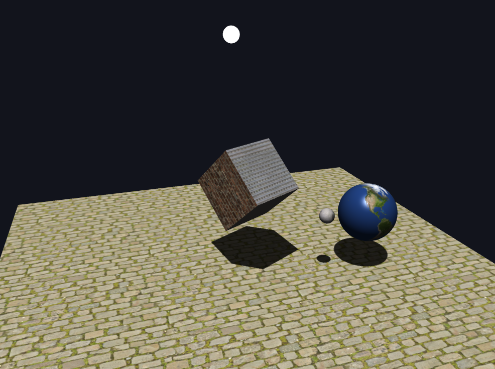
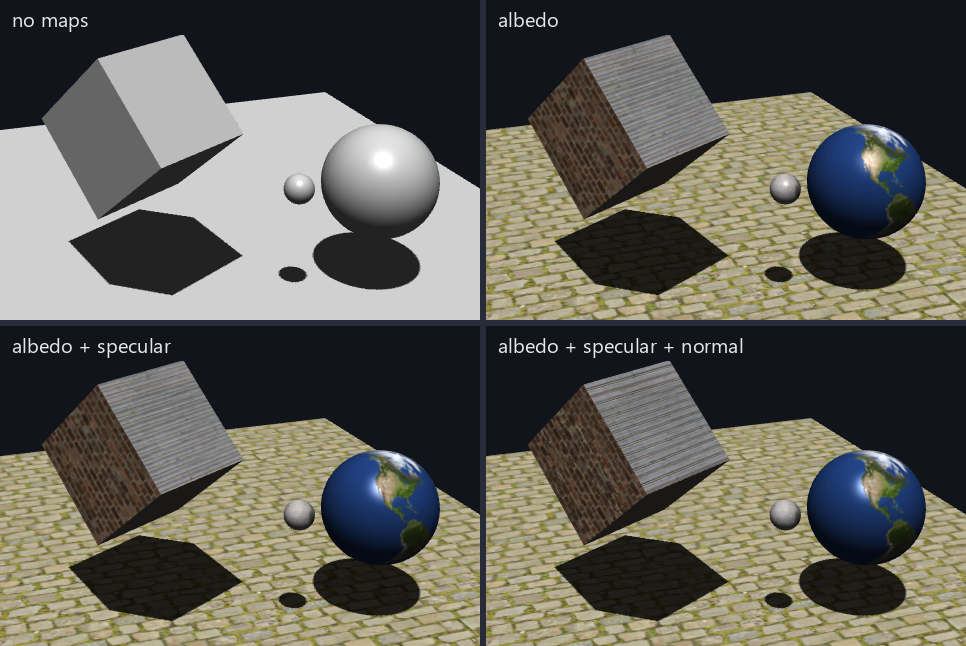
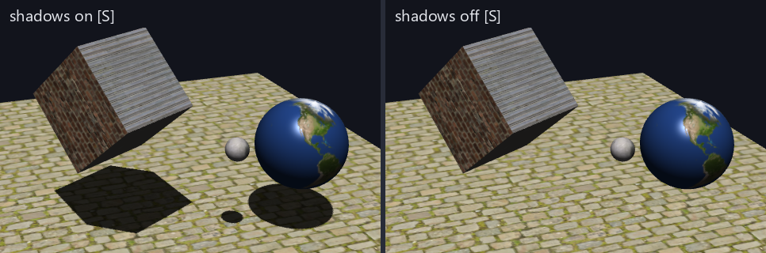
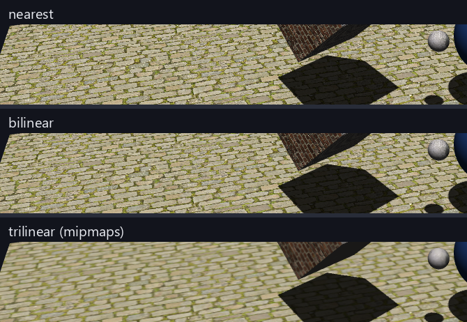

# Task 11 — Textures

> In this assignment, you will add textures to your scene. Take your animated
> scene objects and add textures, for example, an image to each face of the
> cube, the world map to the sphere, etc.
>
> Consider the following textures:
>
> - Albedo (diffuse map)
> - Specular map
> - Normal map
>
> Use the following links as resources and guides:
> https://learnopengl.com/Getting-started/Textures and
> https://learnopengl.com/Lighting/Lighting-maps
>
> You can also animate your light source by showing a small sphere or a cube.
> Switch on/off shadows.
>
> Submit an image showing your result, and update your repository.

**Status:** ✅ done

## Result

The animated scene of tasks 05/07/08: a spinning cube with a different material
on each face (bricks and corrugated steel in view), the Earth orbiting it with
the moon around the Earth, over a paving-stone floor. The sun (white dot) moves
across the sky and every object casts a shadow (task 10):



The same frame as the maps are added one by one (`1`, `2`, `3`). Without maps
everything is grey. The albedo gives each surface its colour; the specular map
makes the oceans shine and the land stay matte; the normal map gives the steel
its ridges and the stones their relief:



Shadows switched on and off with `S`:



The far floor with the three filters (`F`). Nearest and bilinear skip texels
there and shimmer while the camera moves; trilinear reads from mipmaps and
stays smooth:



## Approach

### Texture coordinates, and why this task does not use the CHE

`src/main.cpp`. A `Vertex` now carries `uv`, the point of the image that lands
on it, and `tangent`, the direction in which `u` grows along the surface. The
rasterizer interpolates `uv` like any other attribute, so every fragment looks
up its own texel.

A texture coordinate belongs to a vertex *of a face*, not to a point of the
surface. Where two faces meet with different parts of the image, the same point
needs two `uv`, so it must be two vertices. The CHE of the earlier tasks shares
each vertex among all its triangles, which is right for topology and wrong
here. The meshes therefore come from task 05's `Mesh` (vertex and index arrays):

- **Cube.** 24 vertices, four per face, so each face is its own square of the
  image, `(0, 0)` to `(1, 1)`. The side faces keep `v` pointing up, so images
  are upright on all four. The faces are consecutive in the index buffer, six
  indices each, and are drawn one at a time with their own material.
- **Sphere.** The spherical mapping of the slides, `u` along the longitude and
  `v` along the latitude:

  ```
  P(θ, φ) = (sin φ cos θ, cos φ, −sin φ sin θ)      (u, v) = (θ / 2π, 1 − φ / π)
  ```

  The minus sign makes `u` grow eastwards seen from outside, so the map is not
  mirrored. The seam repeats the vertices of `θ = 0` with `u = 1`; sharing them
  would make the last column of triangles interpolate `u` from 1 back to 0 and
  squeeze the whole map into it.
- **Floor.** `uv` runs from 0 to 4, and with `GL_REPEAT` the image is laid 4 × 4
  times instead of being stretched over 12 units.

### Loading and sampling

`loadTexture()` follows the slides: `stb_image` decodes the file (flipped,
because images store the top row first and OpenGL puts `v = 0` at the bottom),
`glTexImage2D` uploads it and `glGenerateMipmap` builds the chain of half-size
copies. `stb` is a new dependency in `vcpkg.json`; like `happly` in task 06 it
is a header-only library, and `src/stb_image.cpp` is the one translation unit
that compiles its implementation.

`F` cycles the minification filter. Far away, one pixel covers many texels:
**nearest** picks one of them, **bilinear** blends the four around the sample
point, and **trilinear** (`GL_LINEAR_MIPMAP_LINEAR`) blends the two mipmap
levels whose texels are about the size of the pixel, so no texel is skipped.

### Three maps, three terms of the equation

The lighting is task 09's Blinn-Phong with task 10's shadow; each map replaces a
constant of the equation with a value per texel:

```glsl
vec3  albedo = texture(uAlbedoMap,   vUV).rgb;   // kd = ka
float ks     = texture(uSpecularMap, vUV).r;     // ks
vec3  n      = texture(uNormalMap,   vUV).rgb * 2.0 - 1.0;
```

- **Albedo.** The surface colour, used for the ambient and diffuse terms.
- **Specular.** One channel, white where the surface is shiny. The Earth's map
  is white on the oceans and black on land. The other materials come with a
  roughness map instead; the slides define roughness as white = matte,
  black = smooth, so their specular map is `1 − roughness`.
- **Normal.** A direction in **tangent space**, each component stored from
  `[−1, 1]` as a colour in `[0, 1]`: `x` along the tangent, `y` along the
  bitangent, `z` out of the surface, which is why these images are mostly blue.
  The TBN matrix, whose columns are those three axes in world space, brings it
  to world space:

  ```glsl
  vec3 T = normalize(vTangent - dot(vTangent, N) * N); // Gram-Schmidt
  vec3 B = cross(N, T);
  N = normalize(mat3(T, B, N) * n);
  ```

  `B = N × T` points towards growing `v` on all three meshes: up on the cube's
  side faces, north on the sphere, `−z` on the floor.

The shadow test keeps the geometric normal for its bias: the depth comparison
concerns the real surface, the normal map only changes how light is reflected.

A material without an image for some map (the moon has only a colour image)
gets `makeFlatTexture()`, a 1 × 1 texture: a specular of 0.05, and
`(0.5, 0.5, 1)`, the tangent-space normal `(0, 0, 1)`, no relief. The shader
never needs a special case.

Units: 0 is the shadow map for the whole pass; 1, 2 and 3 are the albedo,
specular and normal maps of the object being drawn.

### Reused from earlier tasks

- The scene hierarchy of task 05 (the moon starts from the Earth's anchor).
- The camera of task 08, `common/camera.hpp`, animated by default.
- Task 09's `illuminate()`, now taking the albedo and `ks` as arguments.
- Task 10's sun, shadow map, texel-scaled bias and PCF.

## Textures

All in `textures/`, resized for the repository: 512 px for the ambientCG
materials, 1024 × 512 for the moon and the Earth's normal map, 2048 × 1024 for
the Earth's colour and specular maps, so the continents stay readable.

| File | Source | License | Processing |
|------|--------|---------|------------|
| `earth_*` | [Solar System Scope](https://www.solarsystemscope.com/textures/) | CC BY 4.0 | normal map converted from DirectX to OpenGL (green flipped) and its relief exaggerated × 4 |
| `moon_albedo` | [Solar System Scope](https://www.solarsystemscope.com/textures/) | CC BY 4.0 | resized to 1024 × 512 |
| `bricks_*` | [ambientCG Bricks097](https://ambientcg.com/view?id=Bricks097) | CC0 | 512 px, specular = 1 − roughness |
| `rock_*` | [ambientCG Rock064](https://ambientcg.com/view?id=Rock064) | CC0 | same |
| `steel_*` | [ambientCG CorrugatedSteel009](https://ambientcg.com/view?id=CorrugatedSteel009) | CC0 | same |
| `tiles_*` | [ambientCG Tiles139](https://ambientcg.com/view?id=Tiles139) | CC0 | same |
| `wood_*` | [ambientCG WoodFloor051](https://ambientcg.com/view?id=WoodFloor051) | CC0 | same |
| `fabric_*` | [ambientCG Fabric061](https://ambientcg.com/view?id=Fabric061) | CC0 | same |
| `paving_*` | [ambientCG PavingStones138](https://ambientcg.com/view?id=PavingStones138) | CC0 | same |

The ambientCG normal maps are the `NormalGL` variant, already in the OpenGL
convention. The Earth's was not: on the south face of the Himalaya its green
channel said "facing north", the DirectX convention, so green was inverted.

## Controls

| Key / mouse | Action |
|-------------|--------|
| `1` | Albedo maps on / off |
| `2` | Specular maps on / off |
| `3` | Normal maps on / off |
| `F` | Filter: nearest → bilinear → trilinear |
| `S` | Shadows on / off |
| `SPACE` | Pause / resume the scene, the sun and the animated camera |
| `C` | Switch animated camera ↔ mouse camera |
| Left drag / scroll | Arcball rotation · zoom |
| `R` | Reset scene and camera |
| `ESC` | Quit |

The title bar shows the state of every switch.

## Run

```sh
cmake --build --preset <preset> --target task11
./build/<preset>/task-11-textures/task11
```

The textures are read from `task-11-textures/textures/` (`TEXTURE_DIR`, set by
CMake), so the program runs from any working directory.

## Layout

```
src/
├── main.cpp                     meshes with UVs and tangents, textures, materials, both passes
└── stb_image.cpp                the one translation unit that compiles stb_image
textures/                        albedo, specular and normal map per material
```

## Notes / what I learned

- A texture coordinate is a property of a corner of a face, not of a point in
  space. That is why a textured cube has 24 vertices instead of 8, why a
  textured sphere repeats its seam, and why the CHE, built on shared vertices,
  is not the right structure for this task.
- Each map just replaces a constant of the lighting equation with a lookup:
  `kd`, `ks`, and the normal. The equation itself did not change from task 09.
- A normal map is meaningless without its frame. The same colour means a
  different direction on every face, and the TBN matrix built from the mesh's
  tangent is what gives it one. A wrong convention (the Earth's inverted green)
  turns bumps into dents without any error.
- Mipmaps solve minification, not magnification: up close a texel covers many
  pixels and only bilinear filtering helps; far away a pixel covers many texels
  and only a pre-shrunk copy gives the right average.
- The albedo is used as it is stored, in gamma-encoded colour, like every
  colour in the earlier tasks. A physically correct pipeline would upload it as
  `GL_SRGB8` and gamma-correct the output; the slides mention the format, and
  it is the next step if lighting has to be accurate.
