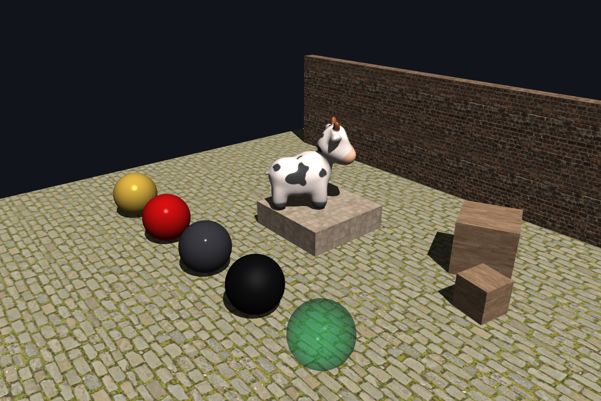
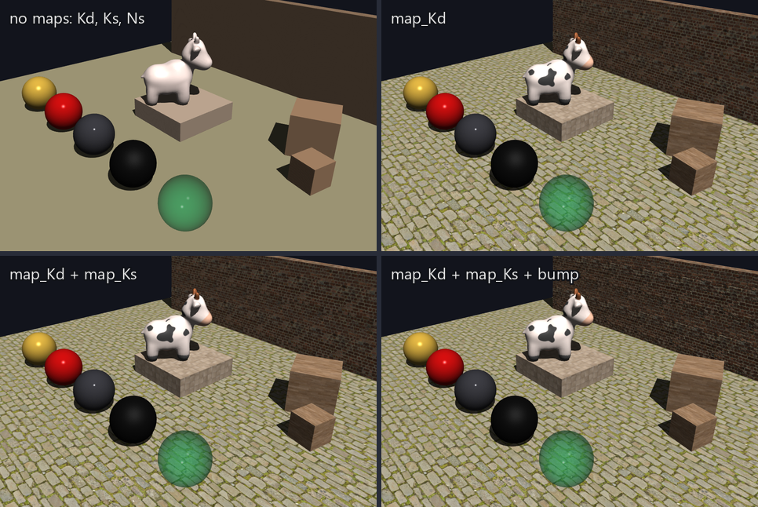
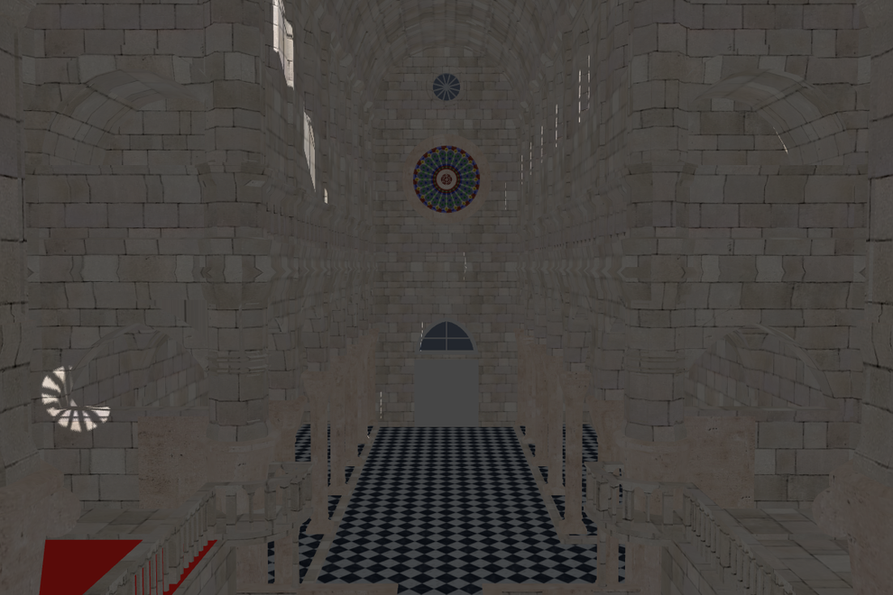
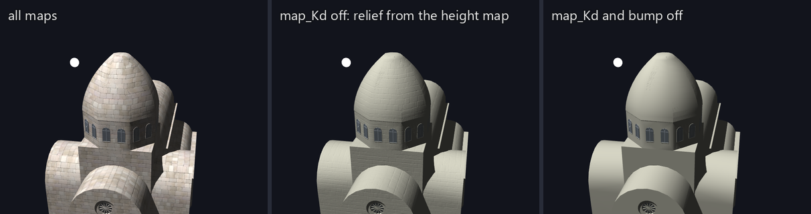
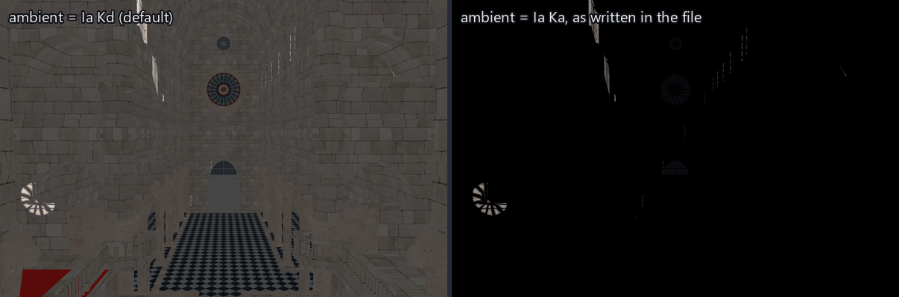

# Task 12 — Loading Scenes

> In this assignment, you will load complete scenes from OBJ scene files
> alongside material properties (Kd, Ks, shininess, etc.) and texture maps using
> Assimp or tinyobjloader, or using another library or your own loader OBJ
> implementation.
>
> Submit an image showing your result, and update your repository.

**Status:** ✅ done

## Result

A gallery scene assembled for this task, read from `scenes/gallery/gallery.obj`
and `gallery.mtl`: eleven objects and ten materials. Spot the cow has its
texture, the floor, wall, pedestal and crates have colour, specular and normal
maps, and the five spheres have no maps at all, only `Kd`, `Ks`, `Ns` and `d`:
gold (the material of the slides), red plastic, chrome, rubber and
semi-transparent glass. The sun of tasks 10/11 moves across the sky and
everything casts a shadow:



The same frame with the maps of the MTL file added one at a time (`1`, `2`,
`3`). Without maps every surface is its `Kd`, `Ks`, `Ns`. `map_Kd` gives the
colour, `map_Ks` varies the highlight across each surface, and the bump map
gives the bricks and stones their relief:



The Šibenik cathedral (75 k triangles, 15 materials), seen from the altar
towards the rose window over the door. Sunlight comes in through the windows
and lands on the columns:



## Approach

The steps follow the pipeline of the slides: read the OBJ, read the MTL,
de-index the mesh, upload it.

### Reading the files — `src/obj_loader.cpp`

[tinyobjloader](https://github.com/tinyobjloader/tinyobjloader) (MIT) does the
text parsing. It reads the global `v`, `vt` and `vn` lists, splits the faces by
object (`o` / `g`), records the `usemtl` of every face and parses every
`newmtl` block of the libraries named by `mtllib`. Polygons are triangulated
as they are read. `stb` and `happly` are handled the same way:
`tinyobjloader` is in `vcpkg.json`, and `src/tiny_obj_loader.cpp` is the one
translation unit that compiles its implementation.

`load_obj()` returns a `Scene` that does not depend on OpenGL:

```
Scene ── materials[]   one per newmtl: Ka Kd Ks Ns d + map paths
      └─ meshes[]      one per o / g
           ├─ vertices[], indices[]   ready for a VBO and an EBO
           ├─ submeshes[]             index ranges that share a material
           └─ position_ids[]          which v each vertex came from
```

### De-indexing v/vt/vn tuples

A face corner in an OBJ is `f v/vt/vn`, three independent indices into three
lists. A vertex buffer has only one index per vertex. The same position can
appear with two different `vt` along a texture seam, or two different `vn`
along a hard edge. That makes it two different vertices, so every **distinct
tuple** becomes one vertex:

```cpp
CornerKey key{corner.vertex_index, corner.texcoord_index, corner.normal_index, ...};
auto found = vertex_of.find(key);           // seen before: reuse its index
if (found == vertex_of.end()) { /* new vertex: copy v, vt, vn */ }
```

In Šibenik, 40,979 positions become 94,848 vertices. In the gallery, 9,175
become 9,758. `position_ids` keeps, for every vertex, the `v` it came from. The
project will need it to weld the split vertices back into one surface for the
half-edge structure (CHE).

Within a mesh the triangles are grouped by material, in the order in which the
materials first appear. A submesh is one index range, so it is drawn with a
single `glDrawElements` call and a single set of uniforms.

### Normals the file does not have

Šibenik has no `vn` at all, and neither does Spot. Their normals are computed
from the faces: each triangle contributes its cross product, whose length is
twice its area, to the corners of its vertices. Averaging across every face at
a vertex would round off the corners of a building. A corner therefore only
takes the faces that bend less than **45°** from its own. Spot comes out
smooth, and the cathedral keeps its hard edges. A computed normal is part of
the de-indexing key, so corners in the same smooth region still merge into one
vertex.

### Tangents

A normal map needs the directions in which `u` and `v` grow on the surface.
Task 11 wrote them by hand for its cube and sphere. Here they are solved per
triangle from its edges and UV deltas (Lengyel's method):

```
e1 = Δu1 T + Δv1 B        [T]        1        [ Δv2  −Δv1] [e1]
e2 = Δu2 T + Δv2 B   →    [B] = ─────────── · [−Δu2   Δu1] [e2]
                                Δu1Δv2−Δu2Δv1
```

The tangents are accumulated per vertex and made perpendicular to the normal.
`tangent.w` stores whether `B` points along `N × T` or against it, which flips
where a texture is mirrored. The shader builds `B = cross(N, T) * w`.

### MTL → shader

The attributes and uniforms follow the table of the slides one to one:

| Property | OBJ / MTL | GLSL |
|----------|-----------|------|
| Positions, UVs, normals | `v`, `vt`, `vn` | `aPos`, `aTexCoords`, `aNormal` (+ `aTangent`) |
| Ambient, diffuse, specular | `Ka`, `Kd`, `Ks` | `uMaterial.Ka`, `uMaterial.Kd`, `uMaterial.Ks` |
| Shininess, opacity | `Ns`, `d` | `uMaterial.Ns`, `uMaterial.d` |
| Maps | `map_Kd`, `map_Ks`, `map_Bump` / `norm` | `uDiffuseMap`, `uSpecularMap`, `uNormalMap` |

The lighting is task 09's Blinn-Phong with exponent `4 Ns` (which matches the
Phong lobe of exponent `Ns`) plus task 10's shadow:

```glsl
albedo = Kd * texture(uDiffuseMap)       ks = Ks * texture(uSpecularMap)
color  = Ia·albedo + (1 − shadow)·(Id·albedo·max(N·L, 0) + Is·ks·max(N·H, 0)^(4 Ns))
```

Choices the files forced on the loader:

- **`map_Kd` replaces `Kd`.** Exporters disagree about what they write in `Kd`
  next to a map. Šibenik has a grey, and the Breakfast Room (Blender) has
  `Kd 0 0 0`, which would make its textures black if the two were multiplied.
  When a material has a diffuse map, the shader gets `Kd = 1`. `Ks` still
  scales `map_Ks`.
- **A missing map is a 1×1 texture.** White for `map_Kd` / `map_Ks`, and
  `(0.5, 0.5, 1)`, the flat normal, for the bump map. The shader never has a
  special case.
- **`map_Bump` can be a normal map or a height map.** The format does not say
  which. `texture.cpp` looks at the image: RGB means a normal map, and a single
  grey channel means a height map. A height map is converted on load. The
  surface `z = h(u, v)` has the normal `(−∂h/∂u, −∂h/∂v, 1)`, and the
  derivatives are central differences between neighbouring texels. This gives
  Šibenik's stone walls their joints. Below, from left to right: all maps, the
  colour map off (the relief comes only from the converted height map), and the
  bump map off as well:

  

- **Ambient uses `Kd`, not `Ka`.** 3ds Max writes `Ka 0 0 0` for every
  material and Blender writes `Ka 1 1 1`. Neither describes the surface. `A`
  switches to the `Ka` of the file to show why. The inside of Šibenik is lit
  almost entirely by ambient light, and with its `Ka = 0` it goes black:

  

- **Glass (`d < 1`) is blended.** Opaque submeshes are drawn first. Glass is
  drawn afterwards with alpha `d`, without writing depth. It is left out of the
  shadow pass, so sunlight goes through the windows.
- **Faces seen from behind are lit from the camera's side.** A scene file does
  not promise that every wall faces the viewer. Šibenik's interior walls are
  seen from their back, so the fragment shader flips the normal when
  `gl_FrontFacing` is false.

### Placing any scene

Šibenik is modelled in metres (40 m long) and Spot in units of about one. The
model matrix scales the longest side of the bounding box to 16, centres it on
the `y` axis and stands it on `y = 0`. The camera, the sun and the sun's
orthographic box (which wraps the bounding sphere) then work for any file. The
built-in scenes add a preset: the cathedral is turned so that the camera stands
in its nave, and it gets a lower sun.

### Reused from earlier tasks

- The shared arcball camera of task 08, `common/camera.hpp`.
- Task 09's Blinn-Phong model, task 10's shadow map with texel-scaled bias and
  PCF, and task 11's TBN matrix, mipmaps and 1×1 fallback textures.
- The file layout and CLI of tasks 04/06: `[scene | path.obj] [--check]` and
  drag-and-drop.

## Scenes

| Folder | Source | License | Processing |
|--------|--------|---------|------------|
| `scenes/sibenik/` | Šibenik cathedral by Marko Dabrovic, holes fixed by Kenzie Lamar, texture and bump maps by Morgan McGuire, from the [McGuire Computer Graphics Archive](https://casual-effects.com/data/) | see `copyright.txt` | glass materials: `Kd` set to their `Tf` colour and `d 0.5` (they had `Kd 0` and no `d`); redundant `Tr` lines removed |
| `scenes/gallery/gallery.obj` | assembled for this task: [Spot](https://www.cs.cmu.edu/~kmcrane/Projects/ModelRepository/) by Keenan Crane plus generated boxes and spheres | Spot: public domain | Spot scaled, turned and placed on the pedestal; `vn` only for the primitives |
| `scenes/gallery/textures/` | `spot_texture.png` by Keenan Crane; the rest are task 11's [ambientCG](https://ambientcg.com) materials | public domain / CC0 | `Kd` of each textured material = mean colour of its image |

The gallery also covers the directives Šibenik does not use: `map_Ks`, `norm`,
`map_Bump` with an RGB normal map, transparency and several objects. Spot has
no normals in the file and the primitives have explicit `vn`, so both paths of
the loader run.

Other scenes can be dropped onto the window. The Breakfast Room of the same
archive (21 objects, 270 k triangles, CC BY 3.0) loads in about 0.3 s. It is
not in the repository because of its size (21 MB).

## Controls

| Key / mouse | Action |
|-------------|--------|
| `1` | `map_Kd` on / off |
| `2` | `map_Ks` on / off |
| `3` | Bump / normal maps on / off |
| `A` | Ambient from `Kd` ↔ from the file's `Ka` |
| `S` | Shadows on / off |
| `TAB` | Next built-in scene (gallery ↔ Šibenik) |
| Drop an `.obj` | Load it |
| `SPACE` | Pause / resume the sun and the animated camera |
| `C` | Switch animated camera ↔ mouse camera |
| Left drag / scroll | Arcball rotation · zoom |
| `R` | Reset the sun and the camera |
| `ESC` | Quit |

The title bar shows the scene, its size and the state of every switch.

## Run

```sh
cmake --build --preset <preset> --target task12
./build/<preset>/task-12-loading-scenes/task12                  # gallery
./build/<preset>/task-12-loading-scenes/task12 sibenik
./build/<preset>/task-12-loading-scenes/task12 path/to/any.obj
./build/<preset>/task-12-loading-scenes/task12 --check          # report, no window
```

`--check` prints what was read from each file, and flags any map that cannot be
found:

```
gallery
  11 objects, 10 materials, 17436 triangles
  9175 positions (v) -> 9758 vertices after de-indexing v/vt/vn
  17568 face corners without vn: normals computed
  bounds (-7.00, -0.20, -7.00) - (7.00, 3.20, 7.00)
  paving               Kd (0.59 0.56 0.44)  Ks (0.60 0.60 0.60)  Ns   24.0  d 1.00
                       map_Kd paving_albedo.jpg  map_Ks paving_specular.png  bump paving_normal.png
  ...
```

The built-in scenes are read from `task-12-loading-scenes/scenes/`
(`SCENE_DIR`, set by CMake), so the program runs from any working directory.

## Layout

```
src/
├── main.cpp                 presets, GPU upload, material binding, both passes
├── obj_loader.hpp/.cpp      OBJ + MTL -> Scene: de-indexing, normals, tangents, submeshes
├── texture.hpp/.cpp         images -> textures, height -> normal maps, cache
├── tiny_obj_loader.cpp      the one translation unit that compiles tinyobjloader
└── stb_image.cpp            the one translation unit that compiles stb_image
scenes/
├── gallery/                 gallery.obj, gallery.mtl, textures/
└── sibenik/                 sibenik.obj, sibenik.mtl, textures, copyright.txt
```

`obj_loader` and `texture` do not know about the rest of the program, so the
project can use them as they are.

## Notes / what I learned

- The OBJ separates what a surface is (`.obj`) from what it looks like
  (`.mtl`), and indexes positions, UVs and normals independently. The GPU does
  neither: one index per vertex, one set of uniforms per draw. The work of a
  loader is that translation: de-index the tuples and group faces by material.
- A file is a promise about syntax, not about content. Normals, tangents,
  `Ka`, what `Kd` means next to a map, whether `map_Bump` is a height or a
  normal map, which way a wall faces: each of them was missing or ambiguous in
  at least one real file, and the loader or the shader has to decide.
- Smooth normals need a crease angle. Averaging every face at a vertex is
  right for a cow and wrong for a building.
- Glass without sorting is only correct while panes do not overlap each other
  on screen. Sorting transparent submeshes back to front, or order-independent
  transparency, is the fix if they do.
- A sun cannot light an interior on its own. Most of what the camera sees in
  the cathedral is ambient light, which is why `Ka` versus `Kd` matters so much
  there. Point lights inside the scene would be the next step.
