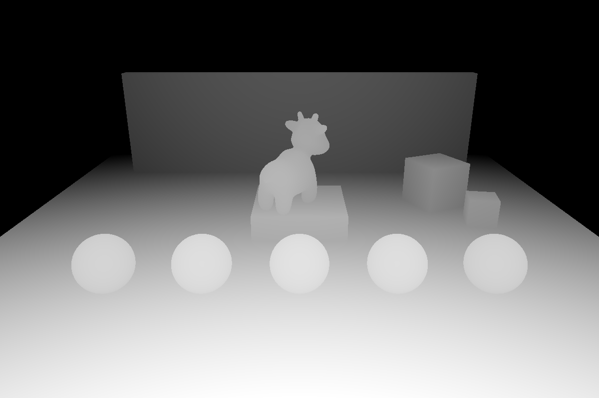

# Task 13 — Depth Map by Ray Casting

> In this assignment, you will render a depth map of your 3D scene from the
> camera viewer. To implement this, cast primary rays from each pixel into the
> scene and record the distance to the nearest surface intersection. Map these
> depth values to pixel intensities to create a grayscale visualization [0:1] of
> the scene's depth buffer. You don't need to implement or use a data structure
> like BVH or k-d trees.
>
> Submit a captured image of your rendered depth map, and update your repository.

**Status:** ✅ done

## Result

Task 12's gallery (11 objects, 16,956 triangles) seen from its camera. One ray
per pixel, 1200 × 800 rays, cast in 0.4 s on the CPU. Near surfaces are white,
far ones dark, and the background, where the rays hit nothing, is black:



## Approach

Nothing here is rasterized. The image comes from the first step of the slides'
path tracer, the primary ray, with the closest hit kept as a distance. OpenGL
only puts the finished image on the screen.

```
for every pixel (x, y):
    ray = primary_ray(x, y)                     ray.hpp
    t   = nearest hit over every triangle       ray_scene.cpp + intersect.cpp
depth(x, y) = t  ->  grey level in [0, 1]       depth_map.cpp
```

### Primary rays — `src/ray.hpp`

`primary_ray()` is the slides' `ray_view_dir`. The centre of the pixel goes to
NDC, `(x, y, 1)` is a point on the far plane, and the inverse of
`projection * view` takes that point back to the world. The ray leaves the
camera's position towards it:

```cpp
vec4 view = {screen.x * 2 - 1, screen.y * 2 - 1, 1, 1};
vec4 q = inv_proj_view * view;
vec3 p = vec3(q) / q.w;                       // undo the perspective divide
return {camera_pos, normalize(p - camera_pos)};
```

The camera is the shared arcball camera of task 08 (`common/camera.hpp`), so the
rays use the same view and projection matrices that the rasterizer would use.
The direction has unit length, so the `t` of a hit is its distance from the
camera.

### Ray-triangle intersection — `src/intersect.cpp`

Möller-Trumbore. A point of the ray, `O + t D`, equals a point of the triangle
in barycentric coordinates, `(1 − u − v) a + u b + v c`. This is a 3 × 3 linear
system in `(t, u, v)`, solved with Cramer's rule:

```
[−D  e1  e2] (t, u, v)ᵀ = O − a        e1 = b − a,  e2 = c − a
```

The ray hits the triangle when `u ≥ 0`, `v ≥ 0` and `u + v ≤ 1`, and the hit is
in front of the camera when `t > 0`. Both faces count, because a scene file does
not promise which way its walls face.

### Nearest hit — `src/ray_scene.cpp`

The OBJ is read with task 12's `obj_loader` and placed with its model matrix.
The ray caster then keeps only what it needs: every triangle in world space,
grouped by object. `closest_hit()` tests all of them and keeps the smallest
`t`. A ray that hits nothing returns `+∞`.

There is no BVH, as the task allows, but each object has its bounding box. A ray
that misses the box of an object, or enters it farther than the closest hit so
far, skips all of its triangles (slab test, `hit_box()`). This is a flat list of
boxes, not a hierarchy. `B` turns it off to compare:

| Gallery, 1200 × 800 | Triangles tested | Time (16 threads) |
|---------------------|------------------|-------------------|
| boxes off (`B`) | all 16,956, for every ray | 71 s |
| boxes on | only those of the objects the ray reaches | 0.4 s |

Both images are identical pixel by pixel. The boxes only skip tests whose
answer is already known.

### Distance to grey — `src/depth_map.cpp`

`render_depth()` keeps one distance per pixel and the nearest and farthest hit
of the image. `to_grayscale()` maps that range to `[1, 0]`:

```
depth = (t − nearest) / (farthest − nearest)    0 at the nearest hit, 1 at the farthest
grey  = 1 − depth                               near is white
```

The background is `+∞`, so it gets 0 like the farthest surfaces. The image uses
its full grey range whatever the size of the scene. Using fixed `near` / `far`
values instead would make the grey of a surface stay the same when the camera
moves, at the cost of contrast.

### Parallel pixels

Every pixel is independent of the others. In the CUDA version of the slides each
pixel is one GPU thread. Here each CPU thread (`std::thread`, one per core)
takes every n-th row, so the rows that see many objects and the rows that see
only the floor are spread evenly across threads.

### Showing it — `src/main.cpp`

The grey levels are uploaded to a one-channel texture (`GL_R8`) and drawn on a
full-screen triangle. The rays are cast again only when the camera moves. While
the mouse drags, they are cast for one pixel in 4 × 4 so the image follows the
mouse; the full-resolution image comes back when the button is released.

### One degenerate triangle

Without the boxes, one pixel at the edge of the chrome sphere came out nearer
than anything else in the scene. The ray hit a triangle at the sphere's pole
whose vertices `b` and `c` are the same point. Its area is zero, so `det` should
be exactly 0, but rounding left it just above the threshold, and dividing by it
gave a meaningless `t`. The box of the sphere had hidden it by luck. The fix is
at the source: `RayScene` drops zero-area triangles (480 in the gallery).

### Scenes and cost

The gallery is read from `task-12-loading-scenes/scenes/` (`SCENE_DIR`), so the
scene is not duplicated. Any other `.obj` can be given as an argument. Task 12's
Šibenik cathedral is 75 k triangles in **one** object, so its box does not help
at all: from inside the nave every ray enters it. It took 496 s, one ray against
every triangle, `O(P · N)`. This is the cost a BVH removes (`O(P · log N)`).

## Controls

| Key / mouse | Action |
|-------------|--------|
| Left drag / scroll | Arcball rotation · zoom (the rays are cast again) |
| `B` | Bounding boxes on / off |
| `S` | Save the current image to `docs/depth.png` |
| `R` | Reset the camera |
| `ESC` | Quit |

The title bar shows the scene, the number of rays, how long they took and the
nearest and farthest distance of the image.

## Run

```sh
cmake --build --preset <preset> --target task13
./build/<preset>/task-13-depth-map/task13                    # gallery, window
./build/<preset>/task-13-depth-map/task13 path/to/any.obj
./build/<preset>/task-13-depth-map/task13 --save             # no window: writes docs/depth.png
```

## Layout

```
src/
├── main.cpp                 scene placement, camera, texture + full-screen triangle
├── ray.hpp                  Ray and primary_ray()
├── intersect.hpp/.cpp       Möller-Trumbore and the slab test
├── ray_scene.hpp/.cpp       world-space triangles per object, closest_hit()
├── depth_map.hpp/.cpp       one ray per pixel in parallel, distance -> grey
├── obj_loader.hpp/.cpp      task 12's OBJ + MTL loader, unchanged
├── tiny_obj_loader.cpp      the one translation unit that compiles tinyobjloader
└── stb_image_write.cpp      the one translation unit that compiles stb_image_write
```

## Notes / what I learned

- Rasterization goes object by object and asks which pixels a triangle covers.
  Ray casting goes pixel by pixel and asks which triangle a ray meets first. The
  depth buffer is the same picture, reached from the other side.
- The primary ray is the inverse of the projection: the same matrices that take
  a vertex to the screen take a pixel back into the world.
- Without an acceleration structure the cost is rays × triangles. One level of
  bounding boxes already cuts it by two orders of magnitude when the scene is
  made of separate objects, and does nothing when it is one big mesh. That is
  what a hierarchy fixes.
- A geometric test that is right on paper still needs care with floating point:
  a triangle with zero area must be removed, not left to rounding.
