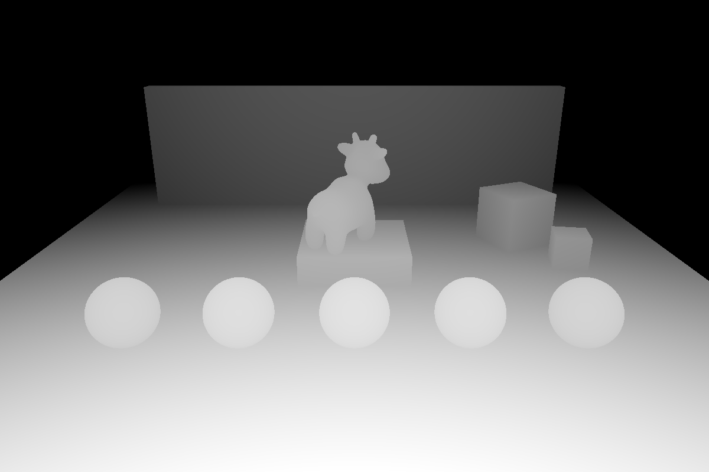

# Task 14 — Depth Map by Ray Casting, in CUDA

> In this assignment, you will render a depth map of your 3D scene from the
> camera viewer. To implement this, cast primary rays from each pixel into the
> scene and record the distance to the nearest surface intersection. Map these
> depth values to pixel intensities to create a grayscale visualization [0:1] of
> the scene's depth buffer. You don't need to implement or use a data structure
> like BVH or k-d trees. Same as Task 13, but your implementation is in CUDA.
>
> Submit a captured image of your rendered depth map, and update your repository.

**Status:** ✅ done

## Result

Task 12's gallery (11 objects, 16,956 triangles) from task 13's camera. One CUDA
thread per pixel, 1200 × 800 rays, cast in 3.5 ms on an NVIDIA RTX PRO 4000
Blackwell (task 13: 0.4 s on 16 CPU threads):



## Approach

Task 13 runs the loop over the pixels on the CPU, one `std::thread` per core
with each thread taking every n-th row. Here each pixel is one GPU thread, as in
the CUDA version of the slides. The scene, the camera, the intersection tests and
the grey mapping are the same as in task 13, so the image is the same.

```
host                                      device
----                                      ------
load OBJ, place it (task 13)
flatten: triangles[], objects[]  ── copy ──>  cast_rays   one thread per pixel
                                              to_grey     one thread per pixel
docs/depth.png  <── copy (1 byte/pixel) ──
```

### The scene on the GPU — `src/gpu_scene.cpp`

Task 13's `RayScene` is a vector of objects, each with its own vector of
triangles. The GPU cannot follow those pointers, so the scene is flattened into
two plain arrays that are each copied with a single `cudaMemcpy`:

- `GpuTriangle { a, e1, e2 }`: vertex `a` and the two edges of Möller-Trumbore,
  computed once here instead of once per ray;
- `GpuObject { box_min, box_max, first, count }`: an object is a range of the
  triangle array and its bounding box.

Zero-area triangles are dropped, as in task 13.

### `cast_rays` — `src/depth_cuda.cu`

Blocks of 16 × 16 threads cover the image. Thread `(x, y)`:

1. builds its primary ray: the pixel centre to NDC, `(x, y, 1)` on the far
   plane, back to the world with the inverse of `projection * view`. The matrix
   travels with the kernel's arguments, so it is in constant memory, shared by
   every thread;
2. tests every object's box (slab test) and, for the objects it enters before
   the closest hit so far, every triangle (Möller-Trumbore), keeping the
   smallest `t`;
3. writes that distance to global memory, `+∞` if it hit nothing.

The grey mapping needs the nearest and farthest hit of the **whole image**, so
the kernel also reduces them. Within a warp, `__shfl_down_sync` folds the 32
values in five steps without shared memory. Then lane 0 merges the warp's
result with one `atomicMin` / `atomicMax`. Those atomics work on `unsigned`, not
`float`. For floats ≥ 0, the order of the bit patterns read as unsigned integers
is the order of the values, so `__float_as_uint` makes them work on distances.
That is one atomic per warp instead of one per pixel.

### `to_grey`

A second kernel, one thread per pixel, maps the distances the way task 13's
`to_grayscale()` does: `grey = 1 − (t − nearest) / (farthest − nearest)`, with
the background black. Only these bytes are copied back to the host, a quarter of
what copying the float distances would be.

### Timing

`cudaEvent`s around the two kernels give the GPU time alone. A host clock
around the whole call adds the allocations and copies. `cuda_device_name()` is
the first CUDA call, so the driver's start-up cost (hundreds of ms) is paid
there and not in the measured render.

| Gallery, 1200 × 800 | CPU, task 13 (16 threads) | GPU, kernels | GPU, with copies |
|---------------------|---------------------------|--------------|------------------|
| boxes on            | 0.4 s                     | 3.5 ms       | 4.3 ms           |
| boxes off (`--no-boxes`) | 71 s                 | 86 ms        | 87 ms            |

GPU: NVIDIA RTX PRO 4000 Blackwell (sm_120, 24 GB), CUDA 12.8. The CPU column
is task 13 on a different machine, so the ratios (about 100× with boxes and
800× without) compare two computers, not only two programs. Both GPU images
are identical byte for byte.

The boxes save less on the GPU (25×) than on the CPU (180×). Without them, every
thread loops over the same 16,956 triangles in the same order, so the 32
threads of a warp stay in step: only the early exits inside one test differ.
With them, neighbouring rays can enter different boxes, and the warp waits
for its slowest thread.

## Build and run

The task needs an NVIDIA GPU and the CUDA toolkit (`nvcc`). The root project
adds it only when CMake finds `nvcc`, so on macOS it is skipped and the other
tasks build as usual.

On a machine without vcpkg, such as a lab PC over SSH, the folder builds on its
own. glm, tinyobjloader and stb are then downloaded by CMake (`FetchContent`):

```sh
cmake -S task-14-depth-map-cuda -B build/task14
cmake --build build/task14 -j
./build/task14/task14                     # gallery -> docs/depth.png
./build/task14/task14 --no-boxes          # every ray against every triangle
./build/task14/task14 --size 1920x1080
./build/task14/task14 path/to/any.obj
```

There is no window: the program writes `docs/depth.png` and prints the GPU, the
number of triangles and rays, the kernel time and the depth range.

By default the code is compiled for the GPU of the machine that builds it
(`native`, CMake ≥ 3.24). `-DCMAKE_CUDA_ARCHITECTURES=<sm>` chooses another one.
Each CUDA version only knows the GPUs released before it. The lab PCs have a
Blackwell GPU (sm_120), but the system's `nvcc` is 12.0 and stops with
`Unsupported gpu architecture 'compute_120'`. Blackwell needs CUDA ≥ 12.8. The
image above was built in a CUDA 12.8 container:

```sh
cmake -S task-14-depth-map-cuda -B build/task14 -DCMAKE_CUDA_ARCHITECTURES=120
cmake --build build/task14 -j
```

## Layout

```
src/
├── main.cpp                 scene placement and camera (task 13), PNG output
├── gpu_scene.hpp/.cpp       the scene flattened into two arrays for the GPU
├── depth_cuda.hpp           plain C++ interface, so only the .cu goes through nvcc
├── depth_cuda.cu            cast_rays and to_grey kernels, device memory, timing
├── obj_loader.hpp/.cpp      task 12's OBJ + MTL loader, unchanged
├── tiny_obj_loader.cpp      the one translation unit that compiles tinyobjloader
└── stb_image_write.cpp      the one translation unit that compiles stb_image_write
```

## Notes / what I learned

- The CPU version already had the right shape for a GPU: every pixel is
  independent. Moving it meant changing the data, not the algorithm. Vectors of
  vectors became flat arrays with index ranges.
- A reduction over the whole image is the one step where pixels are not
  independent. Warp shuffles plus one atomic per warp keep it cheap.
- The GPU image is not bit-identical to the CPU one. The direction of a ray is
  computed with operations in a different order (and nvcc fuses multiply-adds),
  so some pixels change by one grey level, and a ray that passes exactly
  through the edge between two triangles can fall through on one side and not
  the other. Against task 13's image, 222 pixels out of 960,000 differ: 221 by
  one level, and one silhouette pixel on the top edge of a cube, where the GPU
  ray falls through to the wall behind it.
- Device code depends on the CUDA version as well as on the GPU: the same
  source fails with nvcc 12.0 and builds with 12.8 on a Blackwell card.
