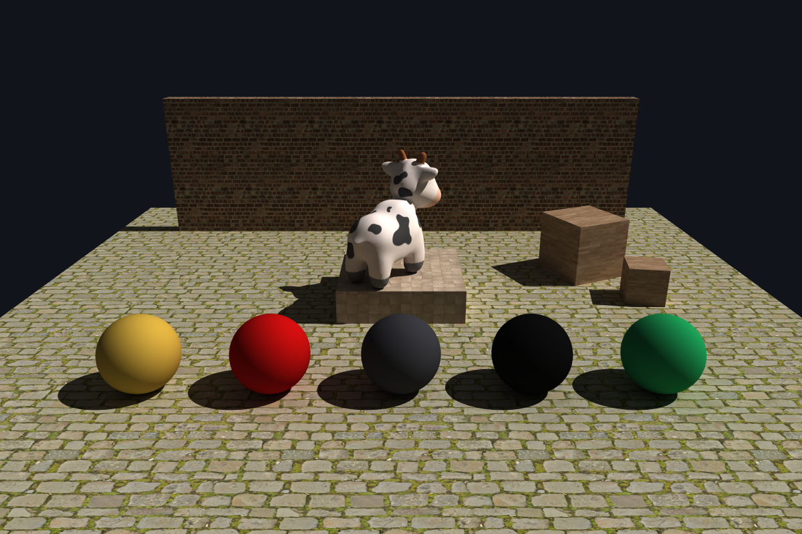
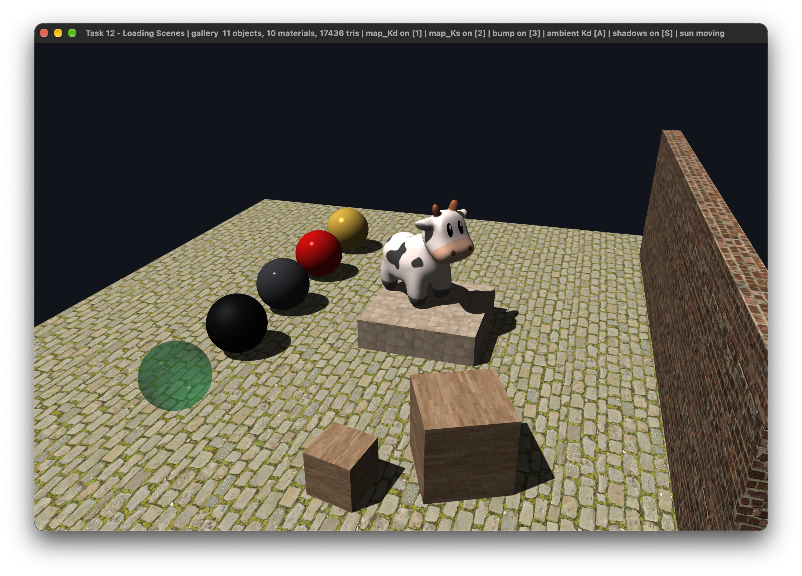

# Task 15 — Simple Path Tracer (offline), CPU vs GPU

> Implement a Simple Path Tracer, considering all surfaces as diffuse. You don't
> need to implement or use a data structure like BVH or k-d trees. Consider
> starting only with primary rays, and shadow rays. Output should be similar to
> the scene rendered with OpenGL with shadows.
>
> Compare the performance, time in seconds of the implementation in CPU vs GPU
> (CUDA).
>
> Submit a captured image of your rendered scene, and update your repository.

**Status:** ✅ done

## Result

Task 12's gallery (11 objects, 16,956 triangles, 5 textures), path traced with
every surface diffuse: 1200 × 800 pixels, 1024 paths per pixel, up to 3
diffuse bounces, 57.7 s on an NVIDIA RTX PRO 4000 Blackwell:



The 64-sample images of the CPU / GPU comparison below are
[`docs/cpu_64spp.png`](docs/cpu_64spp.png) (CPU of the M5 Pro) and
[`docs/gpu_64spp.png`](docs/gpu_64spp.png) (lab GPU).

Task 12 (OpenGL, Blinn-Phong, shadow map) from the same camera and with the sun
at the same position, for comparison:



## Approach

```
for every pixel, for every sample:
    ray = primary ray through a random point of the pixel
    repeat (up to 1 + bounces hits):
        hit = closest_hit(ray)                  nothing: background / sky
        L  += T * albedo * sun * cos * visible  shadow ray towards the sun
        ray = cosine-weighted direction around the normal
        T  *= albedo
pixel = average of its samples
```

### One path tracer, two devices — `src/path_tracer.hpp`

The whole path tracer is one header of `inline` functions: random numbers,
intersection, texture lookup, sampling, `trace_sample()`. Under nvcc the macro
`HD` makes each of them `__host__ __device__`, and for the host compiler it is
empty. `render_cpu.cpp` and `render_gpu.cu` include the same header and only
decide how the pixels are shared out, so the comparison times the same work.

The random numbers come from a hash (PCG) of the pixel, the sample and a seed,
with no state shared between threads, so the CPU and the GPU draw the same
numbers for the same path. An emulation of the CUDA code compiled by the same
compiler as the CPU version gives the same image to the last bit. Built by two
different compilers, the images are not identical (see below).

The math is a small `Vec3` of its own instead of glm, because glm's headers make
nvcc warn about their constructors (task 14).

### The scene — `src/scene_build.cpp`

Task 13's flat arrays, plus what shading needs. The intersection loop only
touches `Triangle { a, e1, e2 }` (36 bytes). Normals, texture coordinates and
material live in a separate `Shading` array that is read once per hit. Each
object keeps its bounding box, still with no BVH. Images are packed one after
another in a single byte array, so the GPU receives them with one copy.

### Primary rays and the camera

Task 13's primary ray, with a random point inside the pixel instead of its
centre. Averaging the samples also smooths the edges (antialiasing). The camera
is task 13's, and the sun is task 12's at time 0 (azimuth 0, elevation 50°).

### Shadow rays: direct light

At every hit, a ray goes towards the sun. If nothing is in the way, the surface
gets Lambert's term of task 09, `albedo · sun · cos θ`. This is task 10's
shadow-map test replaced by an exact visibility test: no resolution, no bias, no
PCF, so the shadow edges are as sharp as the geometry. The shadow ray stops at
the first hit (`occluded()`), since any one is enough.

The sun is a direction, so a bounced ray would never find it by chance.
Asking for it at every hit is *next event estimation*.

### Diffuse bounces: what OpenGL calls ambient

Task 12 adds a constant `Ia · albedo` everywhere. Here, after the shadow ray,
the path continues in a random direction around the normal, with probability
proportional to `cos θ`. With that choice the estimator of a Lambert bounce is
just the albedo, because the BRDF `albedo / π` times `cos θ`, divided by the pdf
`cos θ / π`, leaves `albedo`. A path that escapes finds the sky, whose radiance
is task 12's `Ia = 0.2`, so an open floor gets the same `0.2 · albedo` as in
OpenGL. The difference is what OpenGL cannot do: the ground under the spheres
and the corners of the boxes see less sky and get darker, and the surfaces light
each other (the floor lights the shadowed side of the boxes from below).

Every surface is diffuse, as the task asks. The specular highlights, the normal
maps and the transparency of the green sphere from task 12 are not used. Where
a material has `map_Kd`, the albedo is the image, read with bilinear filtering
and repeat wrapping. There are no mipmaps, and the many samples per pixel
average out the aliasing of the far floor.

### Units, so the images can be compared

The sun's irradiance is chosen so that direct light is exactly OpenGL's diffuse
term. No tone mapping and no gamma are applied, as task 12 writes its colours.
A primary ray that hits nothing shows task 12's clear colour.

### CPU — `src/render_cpu.cpp`

One `std::thread` per core. The threads take rows from a shared atomic counter,
so the expensive rows (spheres, cow) and the cheap ones (sky) are spread
evenly.

### GPU — `src/render_gpu.cu`

The arrays are copied to device memory once. Then each sample is one kernel
launch, one thread per pixel, that adds its path to the pixel's sum. Many short
launches instead of one long one keep each kernel well under the watchdog that
stops long kernels on a GPU that also drives a display. They also add the
samples in the same order as the CPU does.

## CPU vs GPU

1200 × 800, 64 paths per pixel, up to 3 bounces: 61 million paths.

| Machine | Device | Compiler | Time |
|---------|--------|----------|------|
| MacBook Pro M5 Pro | CPU, 15 threads | AppleClang, arm64 | 15.1 s |
| Lab PC | CPU, 24 threads | GCC 11.4, x86-64 | 16.9 s |
| Lab PC | GPU, NVIDIA RTX PRO 4000 Blackwell (sm_120) | nvcc 12.8 | **3.56 s** |

The GPU is **4.7× faster** than the CPU of the same PC, and 4.2× faster than the
M5 Pro. Of its 3.56 s, 3.55 s are the kernels; copying the scene (1.7 MB of
triangles and shading data, 6.3 MB of textures) and the image is negligible.

At 1024 samples the GPU took 57.7 s, 16 times its 64-sample time, as expected:
the cost is linear in the samples.

### Why only 4.7× when task 14 got about 100×

Task 14 cast only primary rays. Neighbouring pixels hit the same objects, so the
32 threads of a warp did nearly the same work. Here that holds only for the
first hit. After a bounce the 32 rays of a warp leave in random directions. One
enters the box of the cow or a sphere and tests thousands of triangles, while
another escapes to the sky after testing a few boxes. Some paths end at the
first bounce and others go on for three. A warp runs in lockstep, so it costs
as much as its slowest thread, and threads that are done sit idle. A CPU core
pays for each ray separately, so the CPU pays the *average* path and the GPU
pays roughly the *worst* of every 32. Without a BVH that gap is large, because a
ray that enters a box tests every triangle inside it. This is the most likely
explanation; it was not profiled. A BVH, or sorting the rays so that a warp
holds similar ones (wavefront path tracing), is what closes it.

### The two images are not bit-identical, and that is expected

| Pair (64 spp) | Pixels that differ | Largest difference | Mean brightness |
|---------------|--------------------|--------------------|-----------------|
| Mac CPU vs lab GPU | 36,511 of 960,000 | 8 levels | — |
| Lab CPU vs lab GPU | 627,174 of 960,000 | 47 levels | 72.87 vs 72.88 |

The random numbers are the same, but the arithmetic is not. nvcc fuses
`a * b + c` into a single instruction (FMA) with one rounding instead of two.
AppleClang does the same on arm64, while GCC targeting plain x86-64 has no FMA
instruction to use. A direction that differs in its last bit can hit a
neighbouring triangle or miss an edge, and from there the path takes different
bounces. The pixel gets a different sample of the same noise. Averaged over 8 ×
8 blocks the difference is 0.2 levels, and the mean brightness differs by 0.01
of a level: the same image up to noise. That is why the Mac CPU (FMA, like the
GPU) is far closer to the GPU than the lab CPU is.

## Build and run

The CPU version builds everywhere, from the root project like every other task.
The GPU version is added when CMake finds `nvcc`.

```sh
./build/<preset>/task-15-path-tracer/task15                # every version built in, 64 spp
./build/<preset>/task-15-path-tracer/task15 --cpu --spp 16
./build/<preset>/task-15-path-tracer/task15 --gpu --spp 1024 --bounces 4
./build/<preset>/task-15-path-tracer/task15 path/to/any.obj --size 1920x1080
```

Each run writes `docs/<cpu|gpu>_<spp>spp.png` and prints the times. When both
versions run, it also prints the speed-up and how many pixels of the two images
differ.

On a machine without vcpkg, such as a lab PC over SSH, the folder builds on its
own, as task 14 does (glm, tinyobjloader and stb are downloaded by CMake). A
Blackwell GPU (sm_120) needs CUDA ≥ 12.8:

```sh
cmake -S task-15-path-tracer -B build/task15 -DCMAKE_CUDA_ARCHITECTURES=120
cmake --build build/task15 -j
./build/task15/task15
```

To capture the OpenGL image above: run `task12`, press `SPACE` (pause), then
`R` (sun and camera back to time 0).

## Layout

```
src/
├── main.cpp                 scene placement, camera, sun, runs CPU / GPU, PNG output
├── vec3.hpp                 Vec3 and the HD macro (__host__ __device__ under nvcc)
├── scene_data.hpp           the flat arrays, SceneView (pointers), RenderSettings
├── scene_build.hpp/.cpp     OBJ + map_Kd images -> the flat arrays
├── path_tracer.hpp          the path tracer, shared by both versions
├── render.hpp               Image, render_cpu(), render_gpu()
├── render_cpu.cpp           std::thread over rows
├── render_gpu.cu            device memory, one kernel launch per sample
├── obj_loader.hpp/.cpp      task 12's OBJ + MTL loader, unchanged
└── tiny_obj_loader.cpp, stb_image.cpp, stb_image_write.cpp
```

## Notes / what I learned

- The shadow map of task 10 answers "does the sun see this point?" from a
  texture. A shadow ray answers it from the geometry, so there is no acne and no
  bias to tune. It only needs an offset along the normal (`kRayOffset`), so the
  new ray does not hit the surface it starts from.
- The ambient term of OpenGL is the integral that a path tracer actually
  computes: the light that arrives from every direction of the hemisphere. With
  bounces it comes out darker where little sky is visible (contact shadows) and
  tinted by the surfaces around.
- The noise falls as 1/√N: four times the samples for half the noise. That is
  why the time of a path tracer is counted in samples per pixel.
- Writing the kernel as a function that both compilers accept keeps a single
  source of truth. The CPU version is also what checked the GPU one before any
  run on an NVIDIA card.
- A GPU is fast when its threads do the same work. Primary rays do, bounced
  rays do not. The same card that was about 100× faster than a CPU in task 14 is
  4.7× faster here, on a scene with no acceleration structure.
- "The same algorithm" does not mean "the same bits": fused multiply-adds
  change the rounding, and a Monte Carlo path amplifies a one-ulp difference
  into a different sample. Comparing two renderers means comparing statistics.
