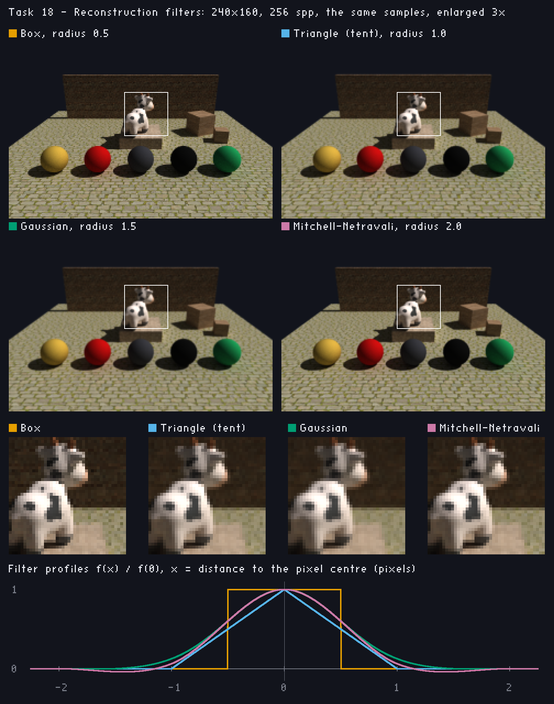

# Task 18 — Reconstruction Filters

> Implement multiple pixel filters in your path tracer, including Box,
> Triangle, Gaussian, and Mitchell-Netravali, to weight the returned ray colors
> based on their distance from the pixel center.
>
> Display a single image comparing the outputs.
>
> Hint: rendered at a lower resolution to highlight the filters' effects.
>
> Submit an image showing the results, and update your repository.

**Status:** ✅ done

Lecture: *Sampling and Reconstruction* (slides 16), section "Image
Reconstruction".

## Result

Task 15's gallery at 240 × 160, 256 samples per pixel. The same samples go
through each of the four filters, so the only difference between the images is
the filter. The images are enlarged 3× by repeating pixels, with no smoothing.
The close-ups (white frame) are 8×, and the profiles of the four filters are at
the bottom:



The four images at their real size: [`box`](docs/box.png),
[`triangle`](docs/triangle.png), [`gaussian`](docs/gaussian.png),
[`mitchell`](docs/mitchell.png).

What the close-ups show, matching the slides' descriptions:

| Filter | Slides | Here |
|--------|--------|------|
| **Box** | "Equal weight. Causes aliasing." | The sharpest, and the most grainy. The paving and the cow's outline step from pixel to pixel, and the texture's fine detail comes through as noise. |
| **Triangle (tent)** | "Linear falloff. Slightly blurry." | Softer edges. The spots on the cow lose their hard border. |
| **Gaussian** | "Infinite support. Smooth, blurs details." | The softest. The grain is gone, and so is part of the detail (the cow's face, the paving joints). |
| **Mitchell-Netravali** | "Negative lobes … sharpening edges. Best balance between ringing and blurring." | Almost as sharp as Box, without its grain. The dark spots and the outline stay crisp. |

## Approach

### Pixels are points: the film — `src/film.cpp`

The slides' rule: *a pixel is a point sample at its centre, not a little square*.
A sample contributes to every pixel whose filter reaches it, weighted by its
distance to that pixel's centre:

```
colour(pixel) = Σ f(x_i − c_x, y_i − c_y) · L_i  /  Σ f(x_i − c_x, y_i − c_y)
```

over the samples `i` within the filter's radius of the pixel centre `c`.
Rendering is split in two steps:

1. **`trace_samples()`** casts `spp` paths per pixel through uniformly random
   points of the pixel's square. Each sample keeps its film position `(x, y)`
   and its radiance `L`. Task 15's `trace_sample()` chose the point itself; its
   copy here, `trace_path()`, takes the point as an argument, because the filter
   needs to know where every sample landed.
2. **`reconstruct()`** applies one filter to those samples. For each pixel it
   gathers the samples of the pixels within `ceil(radius)` of it and weights
   them. Gathering, instead of splatting each sample into its neighbours, lets
   every thread write only its own rows.

Tracing takes 2.4 s for 9.8 M samples (M5 Pro, 15 threads). Each filter then
takes 0.02 s (Box) to 0.2 s (Mitchell): the cost grows with the area of the
footprint, `(2r)²`.

A radius larger than half a pixel is what makes a filter more than an average:
the triangle's samples reach the neighbouring centres (radius 1), the Gaussian
reaches 1.5 pixels and Mitchell 2.

### The filters — `src/filters.cpp`

All four are separable, `f(dx, dy) = f(dx) · f(dy)`. Radii and parameters are
PBRT's defaults, the renderer the slides cite for Mitchell-Netravali:

| Filter | Radius | `f(x)` for `|x| ≤ r` |
|--------|--------|----------------------|
| Box | 0.5 | `1`: exactly the pixel's own square, so it is the plain average of the pixel's samples |
| Triangle | 1 | `1 − |x| / r` |
| Gaussian | 1.5 | `max(0, g(x) − g(r))`, `g(x) = exp(−x² / 2σ²)`, `σ = 0.5` |
| Mitchell-Netravali | 2 | the cubic below, with `x` scaled to `[−2, 2]` |

**The Gaussian.** Its support is infinite (slides), so it has to be cut
somewhere. Subtracting `g(r)` makes it reach 0 at the cut instead of dropping
in a step.

**Mitchell-Netravali.** A piecewise cubic with two parameters `B` and `C`:

```
|x| < 1:  ((12 − 9B − 6C)|x|³ + (−18 + 12B + 6C)x² + (6 − 2B)) / 6
|x| < 2:  ((−B − 6C)|x|³ + (6B + 30C)x² + (−12B − 48C)|x| + (8B + 24C)) / 6
```

`B = C = 1/3` is the pair Mitchell and Netravali recommend. Large `B` blurs and
large `C` rings. The second piece is negative between 1 and 2, which gives the
negative lobes. The neighbours' light is subtracted, so an edge becomes steeper
than the samples alone would make it: the slides' "unsharp mask". The lobes are
shallow, reaching 4% of the peak, so they sharpen without visible halos. The
two pieces meet at `|x| = 1` with the same value, 1/18, and the curve reaches 0
at 2.

With negative weights the sum of the weights could in principle be 0 or
negative. Over a whole footprint of 256-sample pixels it is always positive,
and `reconstruct()` still guards against it.

### The comparison image — `src/main.cpp`

The program writes the comparison image itself: a 2 × 2 grid, the close-ups and
the profiles. The text comes from `stb_easy_font`, whose quads are filled into
the image. The close-up region is fixed in the coordinates of the 240 × 160
image (the cow: black spots on white, and its outline against the wall).

## Run

```sh
cmake --build --preset <preset> --target task18
./build/<preset>/task-18-reconstruction-filters/task18                     # 240x160, 256 spp
./build/<preset>/task-18-reconstruction-filters/task18 --size 160x107 --spp 512 --scale 5
```

Options: `--size WxH`, `--spp N`, `--scale K` (enlargement in the comparison),
`--bounces N`.

## Layout

```
src/
├── main.cpp              scene, camera, sun; runs the filters; draws comparison.png
├── film.hpp/.cpp         trace_samples() and reconstruct(): the weighted average of the slides
├── filters.hpp/.cpp      Box, Triangle, Gaussian, Mitchell-Netravali profiles
├── path_tracer.hpp       task 15's path tracer, with trace_path(film_x, film_y)
├── vec3.hpp, scene_data.hpp, scene_build.*   task 15's scene arrays
├── obj_loader.hpp/.cpp   task 12's OBJ + MTL loader
└── tiny_obj_loader.cpp, stb_image.cpp, stb_image_write.cpp
```

## Notes / what I learned

- Rendering in tasks 15 and earlier used a box filter without saying so: the
  average of the samples inside each pixel is the box of radius 0.5. Choosing a
  filter is choosing how a pixel looks at its neighbourhood.
- Filters trade aliasing for blur. A narrow filter keeps detail and lets
  frequencies above the pixel rate through as grain. A wide smooth one removes
  them, along with real detail.
- Negative lobes buy back sharpness: Mitchell is as wide as the widest filter
  here and still looks sharper than the triangle. Its `C` controls how far that
  goes before halos appear.
- Keeping the samples apart from the pixels makes the comparison fair: one set
  of paths, four reconstructions, the same noise in all of them. In a renderer
  it also means the filter can change without tracing again.
